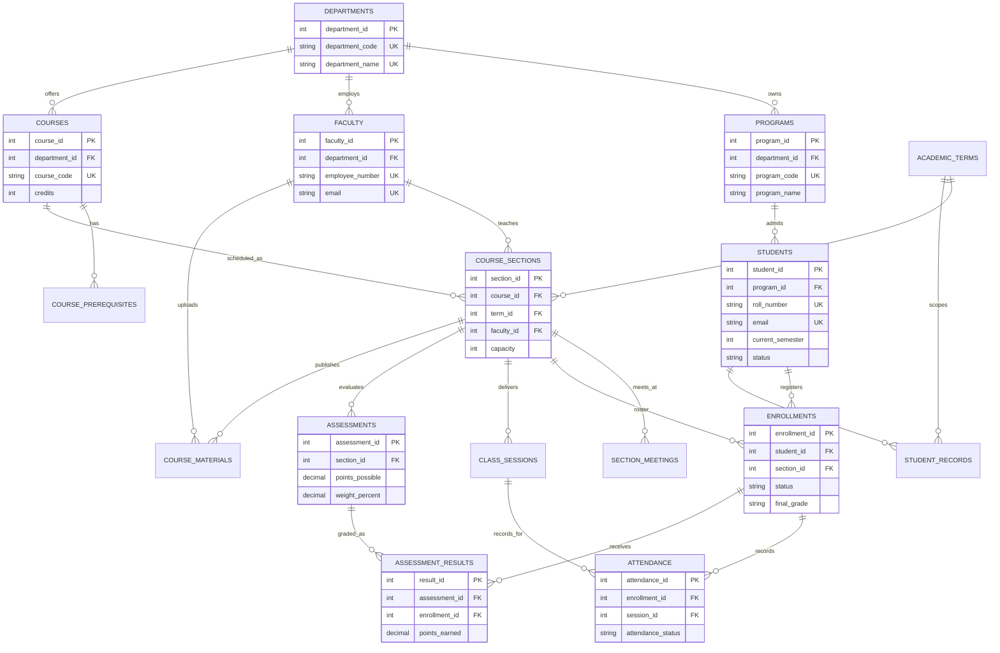

# Student Lifecycle OS ERD

`course_prerequisites` is a recursive many-to-many relation between courses. `enrollments` resolves students to sections, and `assessment_results` resolves enrollments to assessments. Tables use generated primary keys and unique natural identifiers where useful.
